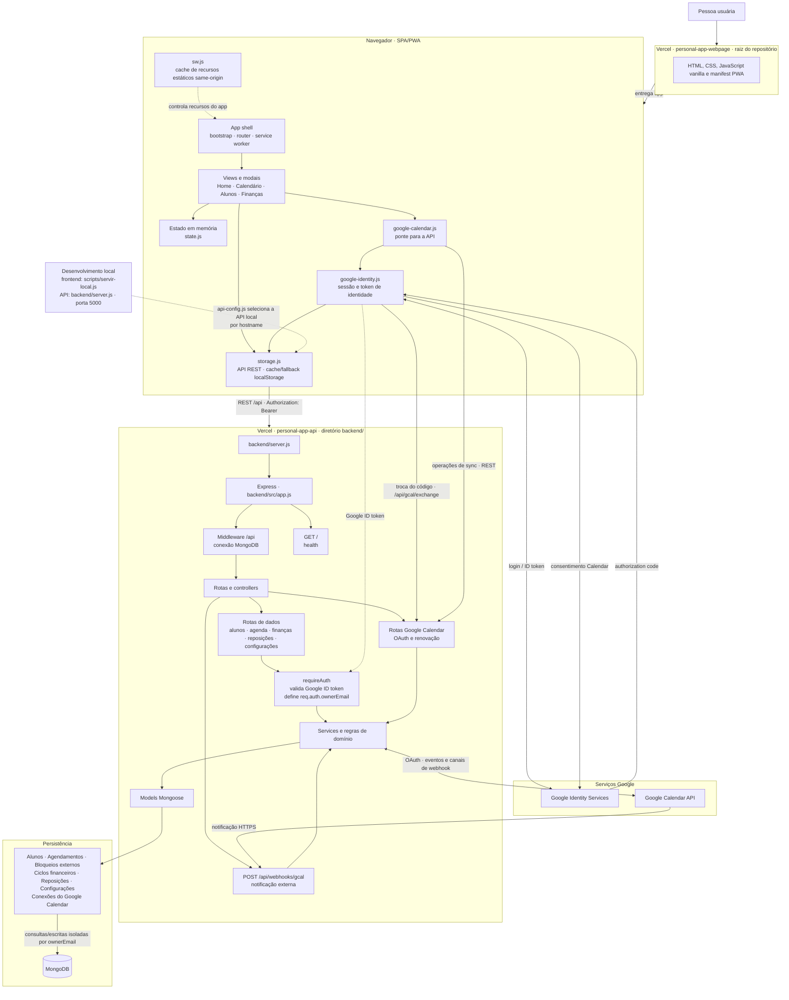

# Arquitetura da aplicação

> **Finalidade**: mapa dos componentes e integrações da aplicação · **Base**: código do repositório em 2026-10-23
>
> Atualizar quando mudarem os limites entre frontend, API, persistência, autenticação, integrações externas ou deploy.

## Diagrama

## Limites e fluxos

- O frontend é servido como arquivos estáticos e inicializa a SPA a partir de [`index.html`](../../index.html). O service worker atende recursos estáticos da mesma origem; requisições `/api/` não entram nesse cache.
- `storage.js` concentra as chamadas REST e o cache/fallback local. O frontend escolhe a URL da API pelo hostname em [`api-config.js`](../../assets/js/config/api-config.js).
- A API Express conecta ao MongoDB antes de processar as rotas `/api`. As rotas de dados passam por `requireAuth`; as rotas de saúde, OAuth do Calendar e webhook têm caminhos próprios, com proteção definida rota a rota.
- `requireAuth` valida o Google ID token e fornece `ownerEmail`. Os controllers e serviços usam esse escopo nas consultas e gravações dos dados.
- A conexão ao Google Calendar usa um fluxo de autorização próprio. O backend acessa a Calendar API e recebe notificações por webhook; o navegador não chama diretamente a API de calendário.
- Os módulos em [`backend/shared/`](../../backend/shared/) são compartilhados entre frontend e backend quando uma regra precisa ser usada nos dois lados.
- Em produção, os projetos Vercel de frontend e API são independentes. Localmente, o frontend servido pelo repositório aponta para a API local na porta 5000.

## Fontes de verificação

- Frontend e carregamento: [`index.html`](../../index.html), [`bootstrap.js`](../../assets/js/app-shell/bootstrap.js), [`storage.js`](../../assets/js/storage.js) e [`sw.js`](../../sw.js).
- API, rotas e persistência: [`server.js`](../../backend/server.js), [`app.js`](../../backend/src/app.js), [`requireAuth.js`](../../backend/src/middleware/requireAuth.js) e [`database.js`](../../backend/src/config/database.js).
- Integração de calendário: [`google-calendar.js`](../../assets/js/google-calendar.js), [`gcalAuthRoutes.js`](../../backend/src/routes/gcalAuthRoutes.js), [`gcalWebhookRoutes.js`](../../backend/src/routes/gcalWebhookRoutes.js) e [`gcalSyncService.js`](../../backend/src/services/gcalSyncService.js).
